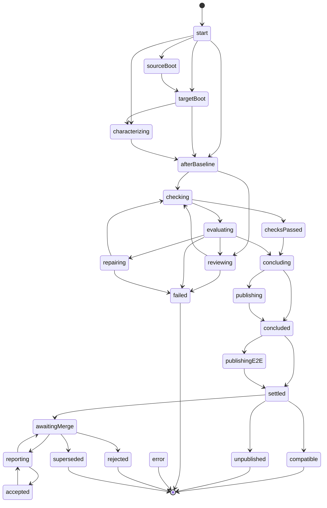

# Workflow reference

The migration workflow of one consumer and one target release, as the statechart in `src/workflow/machine.ts` defines it. This page is generated from `src/workflow/machine.ts` by `scripts/references.ts`; edit the source, not this page. The design is in [the workflow design](../design/workflow.md).

## Overview

Top-level states only; a transition out of a nested state is drawn from its parent. Any state goes to `error` on `activity.error`.

## States

An *activity* state asks the engine for one activity and leaves on its result. A *decision* state leaves immediately on the first guard that holds. A *waiting* state leaves only on an event from outside the job.

| State | Kind | Activity | Description |
| --- | --- | --- | --- |
| `start` | decision |  |  |
| `sourceBoot` | activity | `check` check=boot release=source e2eBaseline= | Boot the unmodified tree on the source release, to classify the outcome. |
| `targetBoot` | activity | `check` check=boot release=target e2eBaseline= | Boot the unmodified tree on the target release. |
| `characterizing` | activity | `characterize` | Run the end-to-end suite, writing it first when there is none, against the unmodified tree on the source release; the tests that pass are the end-to-end baseline. |
| `afterBaseline` | decision |  |  |
| `reviewing` | group |  | The overlap review and the extension-point review, once per migration. |
| `reviewing.overlap` | activity | `session` kind=overlap attempt=0 | The overlap review session. |
| `reviewing.extensionPoints` | activity | `session` kind=extension-points attempt=0 | The extension-point review session. |
| `checking` | group |  | One pass of checks; which checks run depends on the scope of the pass. |
| `checking.next` | decision |  |  |
| `checking.running` | activity | computed from the context | Run the next check of the current pass. |
| `checksPassed` | decision |  |  |
| `evaluating` | decision |  |  |
| `repairing` | activity | computed from the context | Repair attempt n: one agent session given the reviews and the failing check. |
| `concluding` | activity | `inspectTree` | Decide between a proposal and a compatible result from the state of the tree. |
| `publishing` | activity | `publishProposal` | Push the proposal branch and open or update the issue and the pull request. |
| `concluded` | decision |  |  |
| `publishingE2E` | activity | `publishE2E` | Publish the end-to-end suite on its branch, writing or extending it first when there is no end-to-end baseline. It runs after the conclusion, so the proposal never waits for it, and it never blocks. |
| `settled` | decision |  |  |
| `awaitingMerge` | waiting |  | Wait for the maintainer to merge or close the proposal. |
| `accepted` | waiting |  | The proposal was merged and reported; a `report` command can report it again. |
| `reporting` | group |  | Send the merge report to every enabled channel that has not taken it yet. |
| `reporting.next` | decision |  |  |
| `reporting.running` | activity | computed from the context | Send the merge report to the next channel. |
| `compatible` | final |  | The unmodified tree passes every check on the target release. |
| `unpublished` | final |  | The tree changed and passed, and publishing is turned off. |
| `failed` | final |  | The checks still fail; the migration stopped. |
| `error` | final |  | An activity failed for a reason outside the plugin. |
| `rejected` | final |  | The proposal was closed without merging. |
| `superseded` | final |  | A later migration took over the proposal. |

## Transitions

Transitions of one state are tried in order; the first whose guard holds is taken.

| From | On | Guard | To |
| --- | --- | --- | --- |
| any | `activity.error` | — | `error` |
| `start` | immediately | `hasSource` | `sourceBoot` |
| `start` | immediately | `bootEnabled` | `targetBoot` |
| `start` | immediately | `characterizable` | `characterizing` |
| `start` | immediately | — | `afterBaseline` |
| `sourceBoot` | `check.done` | — | `targetBoot` |
| `targetBoot` | `check.done` | `characterizable` | `characterizing` |
| `targetBoot` | `check.done` | — | `afterBaseline` |
| `characterizing` | `e2e.characterized` | — | `afterBaseline` |
| `afterBaseline` | immediately | `initialPassPossible` | `checking` |
| `afterBaseline` | immediately | — | `reviewing` |
| `reviewing.overlap` | `session.done` | `spendCap` | `failed` |
| `reviewing.overlap` | `session.done` | `sessionFailed` | `failed` |
| `reviewing.overlap` | `session.done` | — | `reviewing.extensionPoints` |
| `reviewing.extensionPoints` | `session.done` | `spendCap` | `failed` |
| `reviewing.extensionPoints` | `session.done` | `sessionFailed` | `failed` |
| `reviewing.extensionPoints` | `session.done` | — | `checking` |
| `checking.next` | immediately | `queueEmpty` | `checksPassed` |
| `checking.next` | immediately | — | `checking.running` |
| `checking.running` | `check.done` | `checkFailed` | `evaluating` |
| `checking.running` | `check.done` | — | `checking.next` |
| `checksPassed` | immediately | — | `concluding` |
| `evaluating` | immediately | `notReviewed` | `reviewing` |
| `evaluating` | immediately | `canRepair` | `repairing` |
| `evaluating` | immediately | `advisoryE2EFailure` | `concluding` |
| `evaluating` | immediately | — | `failed` |
| `repairing` | `session.done` | `spendCap` | `failed` |
| `repairing` | `session.done` | `sessionFailed` | `failed` |
| `repairing` | `session.done` | `blockerValid` | `failed` |
| `repairing` | `session.done` | — | `checking` |
| `concluding` | `tree.inspected` | `changedAndPublish` | `publishing` |
| `concluding` | `tree.inspected` | `changed` | `concluded` |
| `concluding` | `tree.inspected` | — | `concluded` |
| `publishing` | `proposal.published` | — | `concluded` |
| `concluded` | immediately | `publishesE2E` | `publishingE2E` |
| `concluded` | immediately | — | `settled` |
| `publishingE2E` | `e2e.published` | — | `settled` |
| `settled` | immediately | `concludedIn(awaitingMerge)` | `awaitingMerge` |
| `settled` | immediately | `concludedIn(unpublished)` | `unpublished` |
| `settled` | immediately | — | `compatible` |
| `awaitingMerge` | `pull-request.closed` | `proposalMerged` | `reporting` |
| `awaitingMerge` | `pull-request.closed` | `proposalClosed` | `rejected` |
| `awaitingMerge` | `proposal.superseded` | — | `superseded` |
| `awaitingMerge` | `command.report` | `newComment` | `reporting` |
| `accepted` | `command.report` | `newComment` | `reporting` |
| `reporting.next` | immediately | `pendingEmptyAndMerged` | `accepted` |
| `reporting.next` | immediately | `pendingEmpty` | `awaitingMerge` |
| `reporting.next` | immediately | — | `reporting.running` |
| `reporting.running` | `report.done` | — | `reporting.next` |

## Guards

| Guard | Holds when |
| --- | --- |
| `bootEnabled` | The boot check is enabled. |
| `hasSource` | A source release is known and the boot check is enabled. |
| `initialPassPossible` | The review policy is `when-checks-fail` and the unmodified tree did not fail the boot check on the target release. |
| `queueEmpty` | Every check of the current pass has run. |
| `checkFailed` | The check failed. |
| `spendCap` | The session was not run, or was stopped, because the spend cap was reached. |
| `sessionFailed` | The session crashed or exceeded its watchdog. |
| `blockerValid` | The repair report declared an upstream blocker with every evidence field. |
| `notReviewed` | The overlap and extension-point reviews have not run. |
| `canRepair` | Repair attempts are left, and the failure fingerprint differs from the one the last repair attempt was given. |
| `advisoryE2EFailure` | The failing check is the end-to-end check, no end-to-end baseline was recorded, and the failure policy is `advisory`. |
| `characterizable` | The end-to-end check is enabled and a source release is known. |
| `publishesE2E` | The end-to-end check is enabled, and an end-to-end baseline was recorded or the tree went through a review. |
| `concludedIn` | The migration concluded in the given state. |
| `changedAndPublish` | The tree changed and publishing is on. |
| `changed` | The tree changed. |
| `proposalMerged` | The closed pull request is this proposal, and it was merged. |
| `proposalClosed` | The closed pull request is this proposal. |
| `pendingEmpty` | Every channel of the reporting pass has been tried. |
| `pendingEmptyAndMerged` | Every channel of the reporting pass has been tried, and the proposal was merged. |
| `newComment` | The `report` command comes from a comment not handled before. |

## Check passes

The checks of a pass run in this order and stop at the first failure. A disabled check is left out.

| Scope | Checks | When |
| --- | --- | --- |
| `initial` | mechanical, boot, web, e2e | The unmodified tree, under the `when-checks-fail` review policy. |
| `attempt` | mechanical, boot, web, e2e | After the reviews and after each repair attempt. |

## Events

Every activity result and every event from outside the job, as the event log stores it.

| Event | Fields |
| --- | --- |
| `check.done` | `result` |
| `session.done` | `kind`, `outcome`, `blocker`, `detail`, `usage`, `report` |
| `e2e.characterized` | `outcome`, `baseline`, `detail`, `usage` |
| `e2e.published` | `outcome`, `detail`, `usage` |
| `tree.inspected` | `changed`, `files` |
| `proposal.published` | `proposal` |
| `report.done` | `channel`, `outcome`, `detail`, `url`, `usage` |
| `activity.error` | `activity`, `detail` |
| `pull-request.closed` | `number`, `merged`, `mergeSha` |
| `proposal.superseded` | `by` |
| `command.report` | `resend`, `comment` |
